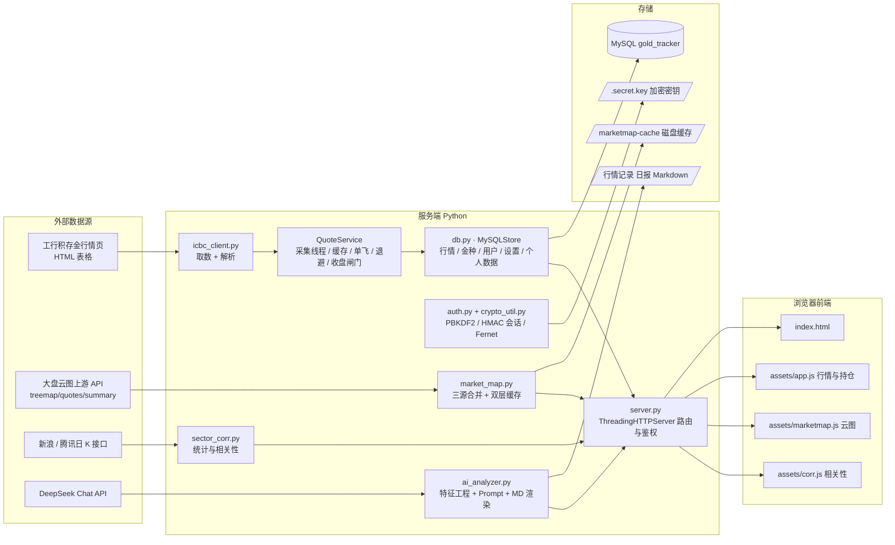

# 工行积存金实盘跟踪网页工具

> 本地运行的个人黄金积存行情跟踪与复盘工具：后台线程持续采集工商银行「积存金」公开行情，落库 MySQL，前端以纯静态页面呈现实时价格、持仓盈亏、K 线、板块相关性、AI 每日复盘。
>
> **本项目仅做数据记录与展示，不接入任何交易接口，不构成投资建议。**

- 仓库地址：<https://github.com/ZZPioneer/icbc-gold-tracker-web>
- 技术栈：Python 3 标准库 HTTP 服务 + MySQL + 原生 HTML/CSS/JS（无前端框架、无构建步骤）
- 运行形态：单进程本地服务，默认监听 `127.0.0.1:8765`，仅本机可访问

---

## 目录

- [1. 项目概览](#1-项目概览)
- [2. 功能特性](#2-功能特性)
- [3. 系统架构](#3-系统架构)
- [4. 核心原理与技术细节](#4-核心原理与技术细节)
- [5. 数据模型](#5-数据模型)
- [6. HTTP 接口参考](#6-http-接口参考)
- [7. 目录结构](#7-目录结构)
- [8. 软件开发生命周期实践](#8-软件开发生命周期实践)
- [9. 安全与合规](#9-安全与合规)
- [10. 已知限制与规划](#10-已知限制与规划)
- [11. 贡献与许可](#11-贡献与许可)

---

## 1. 项目概览

### 1.1 背景

工商银行积存金的实时价格只在官网页面滚动刷新（约数秒一次），页面关闭后历史价格无法回溯，也没有任何成体系的「盘中明细 → 日 K → 复盘」数据。手工截图记账既不可靠也无法做统计。

本项目解决三个具体问题：

1. **留痕**：以 4 秒粒度自动记录每一次报价，形成可回溯的明细序列；
2. **降噪**：把海量明细按自然日聚合为日 K 线，长期保留而库体积可控；
3. **复盘**：在本地完成涨跌特征计算、板块相关性统计与 AI 文字点评，形成每日 Markdown 报告。

### 1.2 设计原则

| 原则 | 落地方式 |
|---|---|
| 采集与展示解耦 | 采集由后台线程驱动，与浏览器是否打开无关；HTTP 只读内存缓存 |
| 失败可降级 | 上游抓取失败 → 保留旧缓存并指数退避；AI 调用失败 → 仍产出完整量化报告；云图/相关性失败 → 返回磁盘旧缓存并标记 `stale` |
| 最小依赖 | 运行期仅 `pymysql`、`cryptography` 两个第三方包，其余全部使用标准库；前端零依赖、零构建 |
| 敏感数据不落明文 | 密码 PBKDF2 哈希；个人数据整包 Fernet 加密后入库；密钥文件与数据库配置被 git 忽略 |
| 只读外部公开页面 | 仅抓取公开行情页与公开行情接口，不登录、不绕风控、不下单 |

---

## 2. 功能特性

### 2.1 积存金跟踪（`/` 默认可视图）

- **实时行情表**：金种、实时主动积存价、最低/最高价、定期积存价、赎回价及各自涨跌方向
- **价格概览卡片**：主动积存价、定期积存价、赎回价、今日价格区间（含区间进度条）
- **价格走势图**：按采集快照绘制 Canvas 折线图，支持时间范围切换、系列开关（主动/定期/赎回/成本/涨跌幅/交易点）
- **我的持仓**：克数 + 成本价 + 计价基准，实时计算浮动盈亏与收益率，保存时在走势图上打点
- **买入/赎回记录**：手动记账，按实时行情计算每笔浮动盈亏或已实现盈亏
- **浮动盈亏面板**：区分「行情涨跌幅」与「我的收益率」两个不同口径，避免误读
- **持仓盈亏走势**：以当前持仓成本回溯历史快照，绘制金额/百分比双曲线
- **K 线走势**：日/周/月三种周期，红涨绿跌，由日 K 聚合数据绘制
- **最近采集记录**：每次成功抓取的原始留痕，红涨绿跌
- **AI 每日分析**：展示当日复盘 Markdown，可手动重新生成，可浏览历史报告
- **金种资料**：为每个金种维护别名、备注、星标、排序

### 2.2 大盘云图

- 6 个市场：A股全图、北交所、ETF、可转债、港股、美股
- 4 个周期：今日、近 5 日、近 20 日、今年以来
- 板块/个股矩形树图（面积 = 市值，颜色 = 涨跌幅），板块缩略统计、搜索定位、自选股、个股日 K / 分时缩略图（经本地服务端图片代理）

### 2.3 盘面分析（板块 × 黄金相关性）

- 31 个行业板块按流通市值加权合成日收益率序列
- 与黄金 ETF（518880）/ 黄金股龙头（600547）做相关性分析
- 输出 Pearson r、Spearman ρ、t 检验 p 值、BH-FDR 校正 q 值、beta、R²、60 日滚动相关、领先滞后相关、累计净值对比、散点图

---

## 3. 系统架构



### 3.1 模块职责

| 文件 | 职责 | 关键约束 |
|---|---|---|
| `server.py` | HTTP 路由、鉴权、后台采集调度、AI 触发 | 只绑 `127.0.0.1`；缓存读与写库分离 |
| `icbc_client.py` | 抓取工行页面并解析为结构化行情 | 纯取数 + 解析，可脱离服务单测 |
| `db.py` | MySQL 数据层、建库建表、旧数据迁移、日 K 聚合 | 每操作短连接，避免跨线程串包 |
| `auth.py` | 密码哈希、会话签发与校验、Cookie 头构造 | 密码不落明文；会话签名不可伪造 |
| `crypto_util.py` | Fernet 对称加密的密钥管理与加解密 | 密钥缺失即生成；密钥损坏时显式报错而非静默重建 |
| `market_map.py` | 云图三源合并、骨架缓存、图片代理 | 骨架周期共享，行情按周期刷新 |
| `sector_corr.py` | 板块加权收益、相关性统计、结果缓存 | 纯 Python 实现统计量，不依赖 numpy/scipy |
| `ai_analyzer.py` | 特征计算、Prompt 构造、报告渲染与归档 | 无 API Key 也产出完整报告 |
| `portfolio_store.py` | 旧版个人数据文件存储（兼容保留） | 原子写入（临时文件 + `os.replace`） |
| `history_store.py` | 旧版 JSONL 历史存储（主链路已改用 MySQL，保留供迁移与测试） | 追加写 + 内存 `deque` 索引 |
| `assets/*.js` | 前端视图逻辑 | 原生 JS，无框架、无打包 |

### 3.2 一次行情请求的数据流

```
后台采集线程 ──每 4s──> IcbcClient.fetch() ──> 解析/校验 ──> 内存缓存(加锁) ──> MySQL 明细入库
                                                                    │
浏览器 ──每 4s 轮询 /api/quote──────> 只读内存缓存 ──────────────────┘
浏览器 ──seq 变化时 ──> GET /api/history ──> MySQL 明细或日 K
```

关键点：**写入路径与读取路径分离**。HTTP 请求不会触发上游抓取（`force=1` 除外，且仍受上游最小间隔保护），因此浏览器关闭、开多个标签页都不会放大对工行站点的请求量。

---

## 4. 核心原理与技术细节

### 4.1 行情采集与解析（`icbc_client.py`）

- **目标页面**：`https://icbcphp.icbc.com.cn/icbc/newperbank/perbank3/gold/goldaccrual_query_out.jsp`（服务端渲染的 HTML 表格）。
- **编码**：页面为 GB 系编码，按 `gb18030` 解码并 `replace` 容错，避免个别非法字节导致整体失败。
- **TLS 兼容**：工行站点使用旧版 TLS 重协商策略，新版 Python/OpenSSL 默认拒绝。代码通过 `ssl.OP_LEGACY_SERVER_CONNECT` 放开，并用 `getattr(..., 0)` 兜底，保证在缺少该常量的旧版本 Python 上仍能启动而不是抛 `AttributeError`。
- **解析方式**：不引入 HTML 解析库，使用预编译正则（该函数位于 4 秒一次的热路径上）：
  - 先按 `<tr>` 切分行，再按 `id="字段_序号"` 提取单元格；
  - 价格字段去标签、去千分位后取数字；
  - 涨跌方向不取自数值差，而取涨跌图标 `alt` 文本，归一为 `up / down / flat`。
- **数据合法性校验**（避免把解析异常写成"历史数据"）：
  1. 没有解析出任何行，或所有行的主动积存价都为空 → 抛异常，本次不入库；
  2. 任一价格不在 `(0, 100000)` 区间 → 抛异常，本次不入库。
- **会话**：`urllib` + `CookieJar` 维持 Cookie，模拟普通浏览器 UA。
- **已停用采集源**：历史版本中的「如意金积存」异步接口已下线，代码中保留产品代码常量用于**清理**历史残留数据，不再抓取、不再入库、不参与日 K 聚合。

### 4.2 采集调度与容错（`QuoteService`）

服务启动即开始采集，不依赖网页是否打开。核心机制：

| 机制 | 作用 | 实现要点 |
|---|---|---|
| 采集间隔 | 默认 4 秒采集一次 | `--collect-interval`；`max(collect_interval, upstream_interval)` 强制不低于上游保护间隔 |
| 上游保护 | 对工行站点最短 2 秒一次 | `--upstream-interval`；手动刷新（`force`）也不能突破 |
| 单飞（single-flight） | 防止并发重复抓取 | `_inflight` 标志位，已有采集在进行则直接返回缓存 |
| 指数退避 | 连续失败时降低压力 | 退避序列 `5s → 10s → 20s → 60s`，成功后计数归零 |
| 收盘闸门 | 每日到点停止采集 | 默认 `22:30`，`--close-at` 可改，`off` 关闭；到点置锁存位，跨天不自动恢复，次日重启进程恢复 |
| 缓存恢复 | 收盘后启动页面不空白 | `restore_cache_from_db()` 只读 MySQL 当天明细（截断到收盘时刻）回填内存缓存，不抓上游、不写库 |
| 变动值服务端计算 | 避免前端用缓存值算出 0 | `_with_deltas()` 用「上一帧快照」与当前帧比较，生成 `delta_*` 字段 |
| 序号 `seq` | 前端判断是否需要重载历史 | 每次成功采集 +1，前端比对 `seq` 变化再拉 `/api/history`，避免无谓请求 |

线程模型：

```
主线程        ThreadingHTTPServer.serve_forever()
采集线程      quote-collector   每 collect_interval 一次，收盘后退出
压缩线程      quote-compactor   每 compact_interval 检查一次日 K 聚合
收盘分析线程  close-ai-analysis 收盘触发一次 AI 复盘
预热线程      marketmap-prefetch / corr-prefetch 启动时后台预热缓存
```

所有后台线程均为 `daemon=True`，主进程退出即回收；`stop()` 中带 3 秒 `join` 超时，保证 Ctrl+C 能及时退出。

### 4.3 分层存储与日 K 聚合（`db.py`）

这是控制库体积的核心设计。

**分层保留策略**

| 粒度 | 表内标记 | 生命周期 | 用途 |
|---|---|---|---|
| 原始明细 | `gran = 0` | 保留最近 `keep_days` 天（默认 2，即今天 + 昨天） | 走势图、盘中高/低点时点、波动率、最大回撤 |
| 日 K 线 | `gran = 1` | 永久保留 | K 线图、「全部」视图、AI 复盘的 OHLC 来源 |

**聚合算法**（`compact_raw`）

- 按自然日遍历，每天每金种生成一根日 K：
  - `open_price` = 当日第一条明细的主动积存价
  - `active`（收盘）= 当日最后一条明细的主动积存价
  - `high` = `max(明细 high ∪ 明细 active)`，`low` = `min(明细 low ∪ 明细 active)`
    ——把 `active` 并入高低价，规避官网 `high/low` 字段偶发缺省；
  - `regular` / `redeem` = 当日最后一个非空值；
  - `fetched_at` 固化为 `当天 00:00:00`，使「每天一个点」在时间轴上对齐。
- **幂等**：同一 `(code, 日期)` 的日 K 先 `DELETE` 再 `INSERT`，重复执行不会产生重复行；
- **事务**：整轮聚合在一个事务中提交，异常回滚；
- **限量**：单次最多处理 `max_days`（默认 ≤ 60）个自然日，从最早日期开始，避免单次任务过长阻塞；
- **删除**：只有当天的日期早于 `cutoff` 才删除明细，且按 500 条一批删除，避免长事务与大 `IN` 列表。

**连接策略**：每个数据库操作独立短连接（`connect_timeout=5`、读/写超时 10 秒），牺牲少量握手开销换取线程安全；写操作额外由 `threading.RLock` 串行化。

**旧数据迁移**：首次运行若库为空，自动把旧版 `history.jsonl` 与 `portfolio-data.json` 导入 MySQL（个人数据自动加密），迁移失败只打印提示、不阻断启动。

**表结构自愈**：`_ensure_quote_columns()` 查询 `information_schema` 补齐后加的 `gran`、`open_price` 字段与索引，兼容老库升级。

### 4.4 认证与数据加密（`auth.py` / `crypto_util.py`）

**密码存储**

- 算法：PBKDF2-HMAC-SHA256，迭代 210,000 次，16 字节随机盐；
- 编码：`pbkdf2_sha256$<迭代次数>$<salt_b64>$<hash_b64>`（算法与参数随哈希串存储，便于后续平滑升级）；
- 校验使用 `hmac.compare_digest` 做常量时间比较，避免时序侧信道。

**会话**

- 无状态签名令牌：`<user_id>.<过期时间戳>.<HMAC-SHA256 签名>`；
- 签名密钥由 Fernet 主密钥派生：`SHA256("session|" + master_key)`，不额外维护第二份密钥；
- 有效期 7 天，Cookie 属性 `HttpOnly; SameSite=Lax; Path=/`。

**账号策略**

- 首个注册用户自动成为 `admin`；之后创建账号必须已登录且为 `admin`；
- 用户名 2–32 字符、密码至少 6 位；重名拒绝。

**个人数据加密**

- 持仓、持仓节点、昨收基准、买卖记录作为一个 JSON 整体，用 Fernet（AES-128-CBC + HMAC-SHA256）加密后存入 `portfolio` 表单行；
- 数据库里只能看到密文，满足「敏感数据非明文存储」；
- 主密钥存于项目根目录 `.secret.key`（权限 `0600`），已被 `.gitignore` 排除；
- **密钥丢失 = 密文不可恢复**；密钥文件损坏时明确抛错，而不是静默重建（静默重建会让旧数据永久不可读）。

### 4.5 大盘云图（`market_map.py`）

上游把数据拆成三个接口，本模块负责合并成与上游网页一致的口径：

| 接口 | 提供内容 | 缓存策略 |
|---|---|---|
| `/treemap` | 板块/个股骨架、市值面积 | 按市场缓存 30 分钟；实测骨架结构与面积与周期无关，故**跨周期共享** |
| `/quotes` | 个股最新价、涨跌幅、成交额 | 随请求刷新，按 `period` 分别缓存 |
| `/summary` | 涨跌家数、总成交额、指数涨跌 | 随请求刷新 |

合并规则：以 `treemap` 为骨架 → 用 `quotes` 按代码覆盖价格类字段 → 用 `summary` 覆盖顶层统计 → `updatedAt` 取三源最大值（ISO 时间字符串同区可比，字典序即时间序）。任一源失败则保留该部分原值并降级，不中断。

**缓存分层**：

- 磁盘：`marketmap-cache/<market>.<period>.json`、`<market>.skeleton.json`、`overview.<period>.json`，写入用「临时文件 + `os.replace`」原子替换；
- 内存：模块级 `RLock` 串行化读写，避免并发抓取重复写入；
- 失败兜底：抓取异常时返回旧缓存并标记 `stale=true` 与 `age`，前端据此显示「缓存快照」提示。

**图片代理**：个股日 K（新浪）与分时缩略图（东财）由服务端代理转发（`/api/marketmap/img`），前端同源访问，规避跨域与 CSP 限制；图片做内存 + 磁盘双层缓存，TTL 6 小时。代码码用白名单正则校验（`^\d{1,10}\.(SH|SZ|BJ|HK)$`），防止 SSRF 式的任意 URL 抓取。

### 4.6 板块 × 黄金相关性（`sector_corr.py`）

**样本构造**

1. 从云图缓存读取行业板块与其成分股（按市值降序取前 N，默认 12 只）；
2. 并发拉取各成分股日 K（新浪优先，腾讯兜底，磁盘缓存按自然日失效）；
3. 用流通市值权重合成板块日收益率：

   $$r^{sector}_{t}=\frac{\sum_i w_i \cdot (P_{i,t}/P_{i,t-1}-1)}{\sum_i w_i}$$

   只接受「$t-1$ 确实是该股在 $t$ 的前一交易日」的样本，**剔除停牌导致的跨期价格跳跃**；
4. 黄金基准取 518880（跟踪上海金，A 股交易时段与板块完全对齐）。

**统计方法**（全部纯 Python 实现）

| 指标 | 说明 |
|---|---|
| Pearson $r$ | 线性相关强度 |
| Spearman $\rho$ | 秩相关，抗异常值（并列取平均秩） |
| $t$ 检验 p 值 | $t=r\sqrt{(n-2)/(1-r^2)}$，经正则化不完全 Beta 函数（Lentz 连分式）求双尾概率 |
| BH-FDR | Benjamini–Hochberg 多重检验校正，31 个板块同时检验时控制假阳性 |
| $\beta$ | $r \cdot \sigma_{sector}/\sigma_{gold}$，板块对黄金的敏感度 |
| $R^2$ | 解释力度 |
| 领先滞后 | 分别计算「板块领先黄金」「黄金领先板块」的一阶错位相关 |
| 滚动相关 | 窗口自适应 `max(20, min(60, n/4))`，保证曲线有足够采样点 |
| 年度化波动率 | 日收益标准差 × √250 |

结果按 `|r|` 降序，摘要接口只返回标量、序列走详情接口，避免首屏传输大数组。内存缓存 6 小时 + 磁盘缓存（`marketmap-cache/corr/`）双重缓存。

### 4.7 AI 每日复盘（`ai_analyzer.py`）

**两段式设计：先算特征，再请 AI 点评。**

1. **本地特征工程**（不依赖网络，永远可产出）：
   - OHLC 优先取日 K；当日日 K 尚未生成时退化为用明细自行聚合；
   - 涨跌基准优先取上一交易日收盘，缺失时退回当日开盘并在报告中标注；
   - 计算涨跌额/幅、实体涨跌幅、振幅、上下影线、K 线形态（十字星/锤子线/流星线/光头光脚等，按实体与影线占比判定）、盘中节奏（高开/低开/平开 + 收盘位置 + 高低点时点）、日内波动率（总体标准差）、最大回撤、采样数；
   - 汇总涨跌家数、平均涨跌幅、领涨/领跌。
2. **调用 DeepSeek**（OpenAI 兼容 `chat/completions`）：
   - 把结构化特征序列化为 JSON 嵌入中文 Prompt，要求四段式输出、引用具体数值、结尾加风险提示；
   - `temperature=0.6`、`max_tokens=1400`；
   - **完全降级**：未配置 Key → `no_key`；网络/鉴权/解析任何异常 → `error`，两种情况都照常写出包含全部量化特征的 Markdown。

**归档**：`行情记录/YYYY-MM-DD.md`，先写 `.tmp` 再 `os.replace` 原子落盘；日期经严格正则 + `strptime` 双重校验，防止目录穿越。

**触发时机**：收盘闸门锁存时自动触发一次（后台线程，且先生成一次日 K 确保 OHLC 准确）；也可通过接口或 `python server.py --analyze 2026-11-21` 单独生成，或在网页中手动重新生成。

---

## 5. 数据模型

数据库 `gold_tracker`（`utf8mb4`，InnoDB），首次运行自动建库建表。

### `quotes` 行情（明细 + 日 K 同表，用 `gran` 区分）

| 字段 | 类型 | 说明 |
|---|---|---|
| `id` | BIGINT UNSIGNED PK | 自增 |
| `code` | VARCHAR(32) | 金种代码 |
| `fetched_at` | VARCHAR(32) | 本地采集时间 / 日 K 为 `YYYY-MM-DD 00:00:00` |
| `source_time` | VARCHAR(32) | 工行页面上的更新时间 |
| `name` | VARCHAR(128) | 金种名称 |
| `active` | DOUBLE | 实时主动积存价（日 K 为收盘价） |
| `open_price` | DOUBLE | 开盘价（仅日 K） |
| `low` / `high` | DOUBLE | 最低价 / 最高价 |
| `regular` | DOUBLE | 定期积存价 |
| `redeem` | DOUBLE | 赎回价 |
| `active_dir` / `regular_dir` / `redeem_dir` | VARCHAR(8) | 涨跌方向 `up/down/flat` |
| `source` | VARCHAR(24) | `page`（页面）/ `kline`（聚合） |
| `gran` | TINYINT | `0` 明细 / `1` 日 K |

索引：`idx_code_time(code, gran, fetched_at)`、`idx_fetched(fetched_at)`、`idx_gran_time(gran, fetched_at)`。

### 其他表

| 表 | 说明 |
|---|---|
| `users` | `id / username(唯一) / password_hash / role / created_at / last_login` |
| `gold_types` | `code(PK) / name / alias / note / starred / sort_order / updated_at` |
| `portfolio` | 单行（`id=1` 约束），`payload` 为 Fernet 密文 |
| `settings` | 通用 KV：`k(PK) / v / updated_at` |

---

## 6. HTTP 接口参考

除标注「免鉴权」者外，所有接口都需要有效的会话 Cookie，否则返回 `401 {"auth_required": true}`。

### 认证

| 方法 | 路径 | 说明 |
|---|---|---|
| GET | `/api/auth/status` | 免鉴权。返回是否已登录、是否需要初始化管理员 |
| POST | `/api/auth/register` | 注册；首个用户成为管理员 |
| POST | `/api/auth/login` | 登录，签发 7 天会话 Cookie |
| POST | `/api/auth/logout` | 清除 Cookie |

### 行情与历史

| 方法 | 路径 | 参数 | 说明 |
|---|---|---|---|
| GET | `/api/quote` | `force=0/1` | 当前缓存快照；`force=1` 触发一次立即采集（仍受退避与上游间隔限制） |
| GET | `/api/history` | `code`、`limit`（≤20000）、`gran=0/1`、`since` | 明细或日 K；收盘后明细自动截断到收盘时刻 |
| GET | `/api/export.csv` | — | 导出全量 CSV（带 BOM，Excel 直接可读） |
| GET | `/api/status`、`/api/health` | — | 免鉴权。采集线程状态、错误计数、下次抓取倒计时、压缩结果、收盘状态 |

### 个人数据与金种资料

| 方法 | 路径 | 说明 |
|---|---|---|
| GET | `/api/portfolio` | 读取个人数据（解密后返回） |
| POST | `/api/portfolio` | 整包保存个人数据（加密入库） |
| GET | `/api/gold-types` | 金种资料列表 |
| POST | `/api/gold-types` | 更新单个金种的别名/备注/星标/排序 |

### 大盘云图

| 方法 | 路径 | 参数 |
|---|---|---|
| GET | `/api/marketmap/markets` | `period` |
| GET | `/api/marketmap/data` | `market`、`period`、`ttl`（4–86400，默认 4）、`force` |
| GET | `/api/marketmap/overview` | `period`、`force` |
| GET | `/api/marketmap/search` | `q` |
| GET | `/api/marketmap/img` | `kind=kline/spark`、`code=600000.SH`（服务端图片代理，缓存 6 小时） |

### 盘面分析

| 方法 | 路径 | 参数 |
|---|---|---|
| GET | `/api/corr/options` | —（基准与窗口选项） |
| GET | `/api/corr/result` | `bench`、`window`、`force`（轻量摘要） |
| GET | `/api/corr/detail` | `bench`、`window`、`sector`（单板块完整序列） |
| POST | `/api/corr/refresh` | 强制重算 |

### AI 分析

| 方法 | 路径 | 参数 |
|---|---|---|
| GET | `/api/analysis/config` | —（是否已配置 Key、模型、自动触发开关、最近一次结果） |
| GET | `/api/analysis/reports` | —（历史报告列表） |
| GET | `/api/analysis/report` | `date=YYYY-MM-DD`（返回 `text/markdown`） |
| POST | `/api/analysis/generate` | `{date?, force?}` |

---

## 7. 目录结构

```
工行积存金实盘跟踪/
├── server.py             # 入口：HTTP 路由 + 采集调度 + 鉴权
├── icbc_client.py        # 工行页面抓取与解析
├── db.py                 # MySQL 数据层（建表/迁移/聚合/CRUD）
├── auth.py               # PBKDF2 密码哈希 + HMAC 签名会话
├── crypto_util.py        # Fernet 加密与密钥管理
├── market_map.py         # 大盘云图三源合并、缓存、图片代理
├── sector_corr.py        # 板块 × 黄金相关性统计
├── ai_analyzer.py        # 涨跌特征工程 + DeepSeek 点评 + Markdown 归档
├── portfolio_store.py    # 旧版个人数据文件存储（兼容保留）
├── history_store.py      # 旧版 JSONL 历史存储（兼容保留）
├── db_config.json        # MySQL 连接配置（已 git 忽略）
├── ai_config.json        # DeepSeek 配置（api_key 由使用者填写）
├── .secret.key           # Fernet 主密钥（已 git 忽略，首次运行自动生成）
├── index.html            # 单页入口：三个一级视图
├── assets/
│   ├── style.css
│   ├── app.js            # 行情、持仓、盈亏、K 线、AI 报告
│   ├── marketmap.js      # 云图交互
│   ├── corr.js           # 相关性图表
│   └── portfolio.js      # 纯函数库：盈亏计算、成本拆分、K 线聚合
├── 启动.bat / 启动.sh     # 一键启动（Windows / macOS·Linux）
├── 行情记录/              # 每日 AI 复盘 Markdown（已 git 忽略）
├── marketmap-cache/      # 云图与日 K 磁盘缓存（已 git 忽略）
├── test_gold_tracker.py  # 解析、存储、采集服务、收盘闸门、鉴权、加密
├── test_ai_analyzer.py   # 特征、渲染、文件、DeepSeek 降级
├── test_corr.py          # 统计函数、收益合成、降级路径
├── test_market_map.py    # 云图合并与缓存
└── test_portfolio.js     # 前端持仓计算（Node 运行）
```

---

## 8. 软件开发生命周期实践

### 8.1 需求阶段

- **范围界定**：只做「公开行情采集 + 本地可视化 + 复盘」，明确不含交易、不含账户登录工行、不含云端多用户。
- **非功能需求**：
  | 类别 | 指标 |
  |---|---|
  | 数据粒度 | 明细 ≤ 4 秒一条 |
  | 上游压力 | 对工行站点 ≥ 2 秒一次 |
  | 可用性 | 上游失败不影响页面读取旧数据 |
  | 存储 | 明细保留 2 天，日 K 永久；单日单金种约 21600 条明细 |
  | 安全 | 仅监听回环地址；密码不落明文；个人数据加密 |

### 8.2 设计阶段

- **分层**：取数（`icbc_client`）→ 调度（`QuoteService`）→ 存储（`db`）→ 接口（`server`）/ 分析（`ai_analyzer`、`sector_corr`）→ 展示（`assets/*.js`）。每层可独立单测。
- **故障设计**：所有外部依赖（工行、云图、日 K、DeepSeek）都有「失败 → 降级 → 保留旧数据」的明确路径，没有一条失败会连带页面不可用。
- **技术选型理由**：
  - 用标准库 `ThreadingHTTPServer` 而非 Web 框架：单机单用户场景，省去依赖与启动开销；
  - 用 MySQL 而非 SQLite：明细写入频率高（4 秒一次 × 多金种），需要独立事务与并发连接；
  - 前端不引入框架与构建工具：页面逻辑集中在少数几个文件，静态资源由服务端直接托管。

### 8.3 开发阶段

- **编码约束**：
  - 运行期第三方依赖上限 2 个（`pymysql`、`cryptography`）；
  - 所有文件写入使用「临时文件 + `os.replace`」保证原子性；
  - 所有共享状态用 `RLock` 保护，写库在锁外执行，避免慢查询阻塞读；
  - 外部输入（日期、代码、图片参数、请求体大小）一律校验；SQL 全部参数化。
- **代码组织**：模块顶部写职责说明与关键设计决策注释，便于后续维护与评审。

### 8.4 测试阶段

**后端单元测试（`unittest`，63 项，实测全部通过）**

```bash
python -m unittest test_gold_tracker test_ai_analyzer test_corr test_market_map
```

覆盖范围：

| 测试文件 | 重点 |
|---|---|
| `test_gold_tracker.py` | 页面解析、如意金排除、存储、采集服务、收盘闸门、鉴权、加密 |
| `test_ai_analyzer.py` | 特征计算、Markdown 渲染、报告落盘、DeepSeek 未配置/失败降级 |
| `test_corr.py` | Pearson/Spearman/p 值/BH-FDR、板块收益合成、停牌剔除、样本不足降级 |
| `test_market_map.py` | 三源合并、骨架复用、缓存命中与失败兜底 |

**前端测试**

```bash
node test_portfolio.js
```

**手工验收清单**

- [ ] 首次启动：自动建库建表，页面提示注册管理员
- [ ] 未登录访问 `/api/quote` 返回 401，前端弹登录框
- [ ] 关闭浏览器后 `quotes` 表仍在按 4 秒增长
- [ ] 断开网络：页面仍显示上次数据，`/api/status` 的 `consecutive_errors` 增长，恢复后自动继续
- [ ] 跨过收盘时间：采集停止、页面仍可查当天定格数据
- [ ] 未配置 DeepSeek Key：仍生成完整特征报告，AI 段标注未配置

### 8.5 部署与运行阶段

**环境要求**

- Python ≥ 3.8（实测 3.14）
- MySQL 5.7 或 8.0（`portfolio` 表的 `CHECK (id = 1)` 在 5.7 中被忽略、8.0.16+ 生效，均不影响使用）
- 依赖：`pymysql`、`cryptography`（启动脚本会自动检测并安装）

**方式一：一键启动**

```bash
# Windows：双击 启动.bat，或
启动.bat 9000          # 自定义端口

# macOS / Linux
./启动.sh 9000
```

脚本会依次：定位 Python → 检查/安装依赖 → 探测 MySQL 连通性 → 打开浏览器 → 启动服务。

**方式二：命令行**

```bash
pip install pymysql cryptography
python server.py --port 8765
```

**可用参数**

| 参数 | 默认值 | 说明 |
|---|---|---|
| `--port` | `8765` | 监听端口（固定绑定 `127.0.0.1`） |
| `--upstream-interval` | `2.0` | 对工行站点的最小抓取间隔（秒） |
| `--collect-interval` | `4.0` | 后台记录间隔（秒） |
| `--compact-interval` | `600` | 明细压缩检查周期（秒） |
| `--keep-days` | `2` | 明细保留天数 |
| `--close-at` | `22:30` | 当日停止采集时间，`off` 关闭闸门 |
| `--db-config` | — | 指定 MySQL 配置文件路径 |
| `--analyze [YYYY-MM-DD]` | — | 只生成指定日期复盘后退出，不启服务 |
| `--no-auto-analysis` | 关闭 | 禁用收盘自动生成复盘 |

**首次使用**

1. 确认 MySQL 已启动，按需修改 `db_config.json`（默认 `root/123456@127.0.0.1:3306`）；
2. 启动服务，浏览器打开 `http://127.0.0.1:8765/`；
3. 注册管理员账号（首个账号自动为管理员）；
4. 如需 AI 点评，在 `ai_config.json` 填入 DeepSeek `api_key` 后重启。

### 8.6 运维阶段

**健康检查**：`GET /api/status` 返回 `collector_alive`、`compactor_alive`、`consecutive_errors`、`next_fetch_in`、`seq`、`market_closed`、`last_compact`，可直接用于脚本告警。

**日志**：标准输出中的结构化行，前缀 `gold-tracker`，包含抓取失败原因、压缩结果、AI 生成结果。用 `python server.py > tracker.log 2>&1` 落盘（`*.log` 已 git 忽略）。

**数据备份**

| 对象 | 建议 |
|---|---|
| MySQL `gold_tracker` | `mysqldump` 定期备份（行情可重建，`users`/`portfolio` 不可重建） |
| `.secret.key` | **必须与数据库一起备份**，否则 `portfolio` 密文永久不可读 |
| `ai_config.json` | 含 API Key，按密钥管理 |
| `行情记录/` | Markdown 报告，可直接归档或纳入版本管理 |

**容量治理**：明细清理由压缩线程自动完成；若需缩短/延长明细窗口，调整 `--keep-days`；若需彻底清理某日数据，先停服务再操作数据库。

**升级**：新版本启动时会自动补列、补索引，无需手工迁移；旧 JSONL / JSON 数据仅在目标表为空时迁移一次。

### 8.7 版本与变更管理

- 版本号体现在 `Handler.server_version`（当前 `GoldTracker/3.0`）；
- 提交信息采用 `feat/fix/chore + 中文描述` 风格；
- 数据库结构变更必须同时提供「向前兼容」的补列逻辑（参考 `_ensure_quote_columns`）。

---

## 9. 安全与合规

### 9.1 安全设计

| 威胁 | 缓解措施 |
|---|---|
| 密码泄露 | PBKDF2-HMAC-SHA256（21 万次迭代 + 随机盐），常量时间比较 |
| 会话伪造 | HMAC-SHA256 签名 + 过期时间；Cookie `HttpOnly`、`SameSite=Lax` |
| 个人数据明文落库 | 整包 Fernet 加密，密钥仅存本地文件 |
| XSS / 点击劫持 / MIME 嗅探 | 全站 CSP（`default-src 'self'`、禁 `object-src`）、`X-Frame-Options: DENY`、`X-Content-Type-Options: nosniff`、`Referrer-Policy: no-referrer` |
| SQL 注入 | 全部语句参数化；字段名白名单映射 |
| 路径穿越 | 报告日期严格正则 + 日期解析校验；静态资源路径为固定白名单表 |
| SSRF | 图片代理只接受 `kind ∈ {kline, spark}` 且代码匹配 `^\d{1,10}\.(SH\|SZ\|BJ\|HK)$` |
| 请求体攻击 | 请求体大小上限 2 MB，必须为 JSON 对象 |
| 服务外暴露 | 仅绑定 `127.0.0.1`，默认不对局域网开放 |

> 若需局域网访问，请自行在最外层加反向代理并启用 HTTPS 与访问控制；**不建议**直接把 `127.0.0.1` 改成 `0.0.0.0`。

### 9.2 合规边界

- **数据来源**：仅访问工商银行官网公开的积存金行情查询页面，以及公开的市场行情接口；不登录个人账户、不读取任何账户信息、不调用交易接口。
- **访问频率**：内置上游最小间隔（默认 2 秒）与指数退避，避免对目标站点造成压力。
- **数据用途**：全部数据保存在使用者本机数据库中，不上传、不外发、不做二次分发。
- **个人数据**：持仓与交易记录属于使用者自行录入的个人财务数据，加密存储在本机，使用者可随时删除。
- **AI 调用**：仅在显式配置 DeepSeek Key 后，将**聚合后的行情特征**（价格、涨跌幅、影线、波动率等）发送至 DeepSeek；不发送账号、持仓、密钥等任何个人信息；未配置 Key 时完全离线运行。
- **免责声明**：行情数据来自第三方公开页面，可能存在延迟、缺漏或解析偏差；本项目为个人学习与技术实践用途，**不构成投资建议，据此操作风险自负**。

### 9.3 密钥与配置管理

已被 `.gitignore` 排除、**切勿提交**：

```
.secret.key        # Fernet 主密钥
db_config.json     # 数据库口令
行情记录/           # 个人复盘内容
marketmap-cache/   # 缓存数据
```

`ai_config.json` 会被提交，但其中 `api_key` 应保持为空；请勿把真实 Key 提交到仓库。

---

## 10. 已知限制与规划

**已知限制**

- 单机单用户定位：`portfolio` 为单行存储，所有账号共享同一份个人数据；多人使用需自行扩展为按用户隔离。
- 前端文案中部分「仅保存在本浏览器」为旧版描述，实际为「MySQL 加密存储，浏览器 localStorage 兜底」，以本文档为准。
- 收盘闸门到点后不自动跨天恢复，需重启服务（设计如此，避免无人值守时长期运行）。
- 明细保留窗口默认仅 2 天，盘中特征（波动率、回撤）对更早日期自动降级为日 K 级别。
- 相关性分析依赖云图缓存，首次使用需先打开一次大盘云图或等待预热完成。
- `history_store.py` 为历史兼容代码，主链路已改用 MySQL，仅保留迁移与测试用途。

**后续规划**

- 个人数据按用户隔离（`portfolio` 增加 `user_id`）
- 报告导出 PDF / 邮件推送
- 采集异常与收盘结果的通知渠道
- 前端文案与存储实现对齐

---

## 11. 贡献与许可

- **提交规范**：`feat: 新增…` / `fix: 修复…` / `refactor: 重构…` / `docs: 文档…` / `test: 测试…`
- **提交前自检**：`python -m unittest test_gold_tracker test_ai_analyzer test_corr test_market_map` 全绿；确认未提交 `.secret.key`、`db_config.json` 与真实 API Key。
- **许可证**：当前仓库**未声明开源许可证**，默认保留所有权利。如需对外分发或商用，请先补充 `LICENSE` 文件（如 MIT / Apache-2.0）并说明第三方数据来源的使用条款。

---

*行情数据来源：中国工商银行官网公开页面；大盘与个股行情来自公开市场数据接口。本工具与上述机构无隶属关系。*
